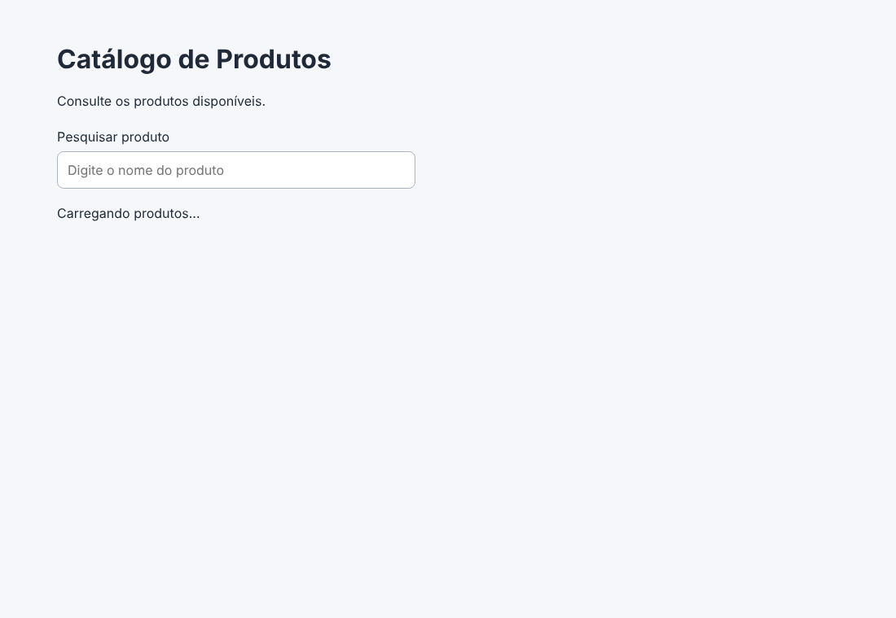
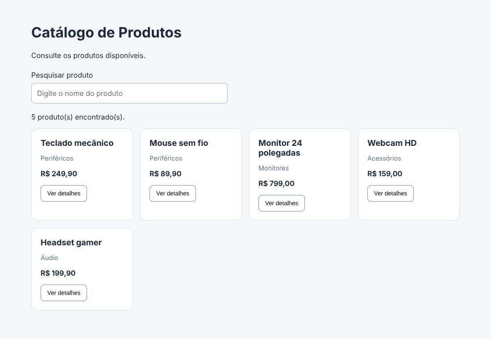
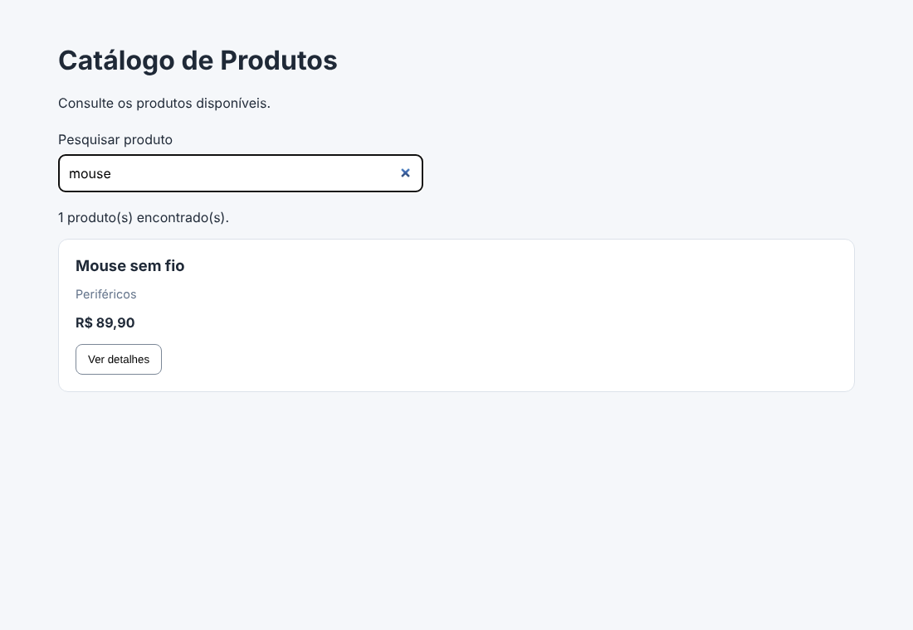
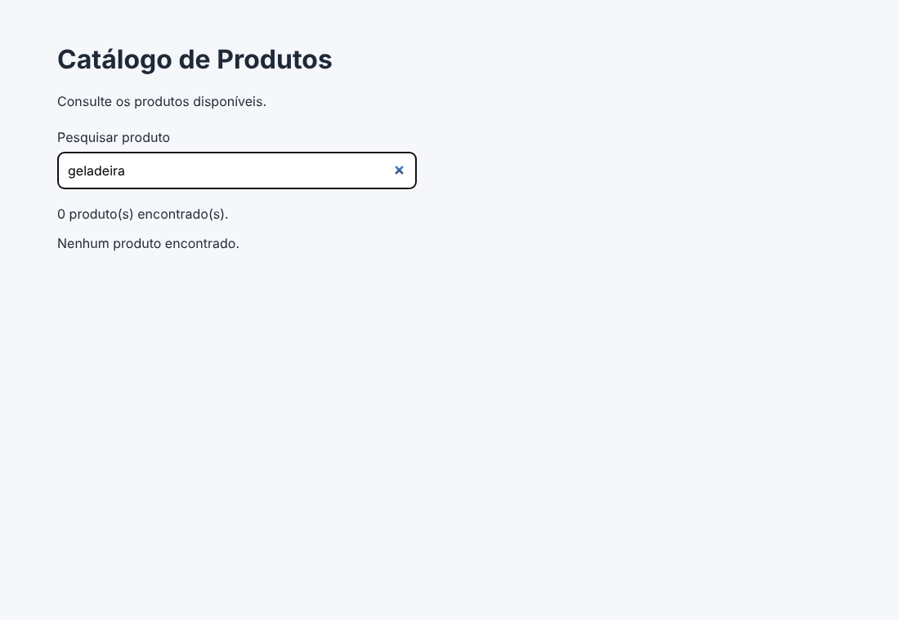
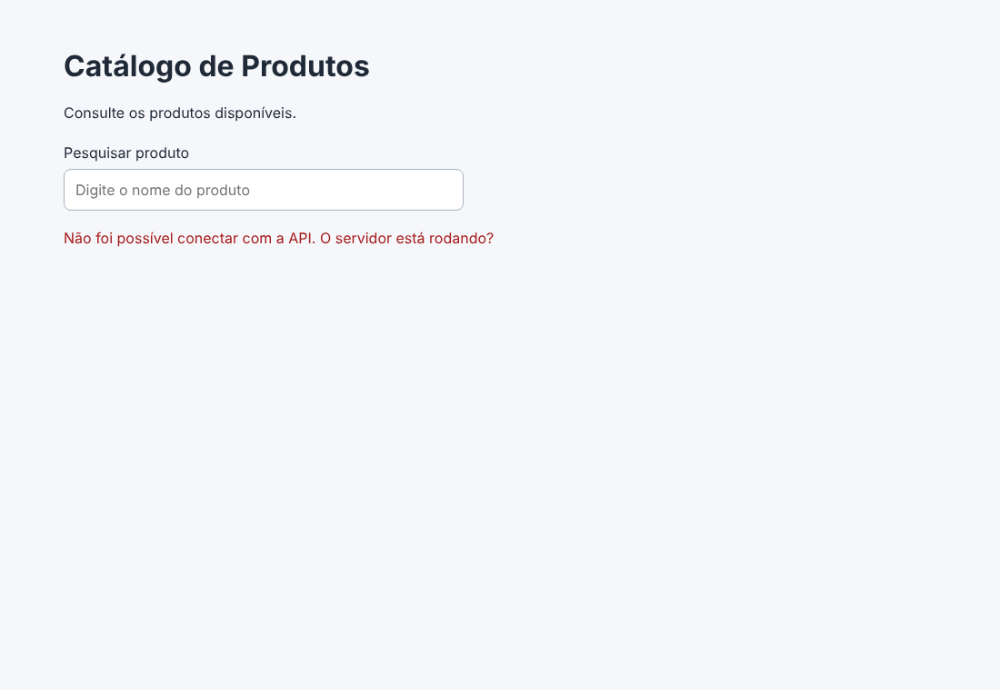
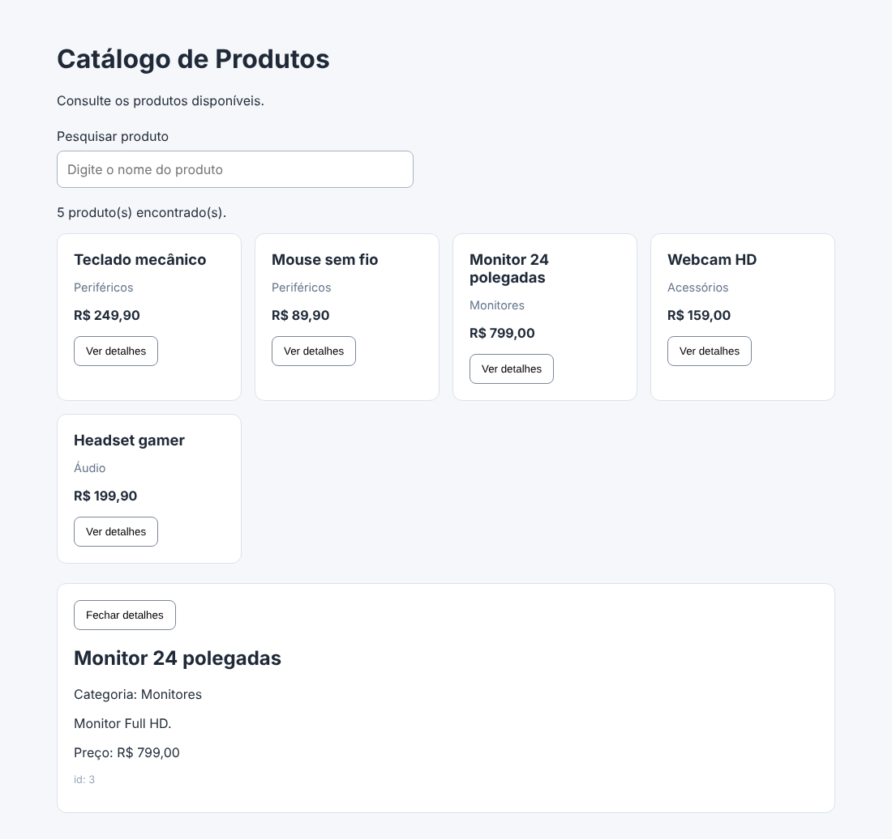

# Catálogo de Produtos - React

Guilherme Ferreira Valadares - 914106
Engenharia de Software - PUC Minas

SPA em React (Vite) que lista produtos de uma API REST, pesquisa por nome e mostra os detalhes de um produto sem recarregar a página.

## Como rodar

Precisa do Node instalado (usei o 22).

```
npm install
```

### 1. Subir a API

Se for usar a API da turma, é só ela estar rodando e o endereço estar certo no `.env` (próximo passo).

Pra testar em casa sem a API da turma eu fiz uma API fake bem simples dentro da pasta `api-fake/`, que usa os mesmos produtos do `src/data/products.js`. Ela coloca um atraso de meio segundo de propósito pra dar pra ver o "Carregando...".

```
npm run api
```

Ela sobe em `http://localhost:3000` com:

- `GET /produtos` -> array de produtos
- `GET /produtos/:id` -> um produto (404 se não existir)

### 2. Configurar o endereço da API

Arquivo `.env` na raiz (mesmo nível do `package.json`):

```
VITE_API_URL=http://localhost:3000
```

Trocar pelo endereço da API real se for o caso. Tem um `.env.example` igual de modelo. **Depois de mexer no .env tem que parar e rodar o `npm run dev` de novo**, o Vite só lê ele quando inicia (perdi um tempo com isso).

A API precisa liberar CORS pro endereço do Vite, senão o navegador bloqueia. Na API fake isso tá feito com o header `Access-Control-Allow-Origin`.

### 3. Rodar o front

Em outro terminal:

```
npm run dev
```

E abrir o endereço que aparece (normalmente `http://localhost:5173`).

## Árvore de componentes

```
App  (estados: products, search, loading, error, selectedId, selectedProduct, detailsLoading, detailsError)
├── Header
├── ProductSearch      (recebe value + onSearchChange)
├── ProductList        (recebe products filtrados + onViewDetails)
│   └── ProductCard    (um por produto, recebe product + onViewDetails)
└── ProductDetails     (só aparece com selectedId != null; recebe product, loading, error, onClose)
```

Estrutura das pastas:

```
src/
├── main.jsx
├── App.jsx
├── App.css
├── components/
│   ├── Header.jsx
│   ├── ProductSearch.jsx
│   ├── ProductList.jsx
│   ├── ProductCard.jsx
│   └── ProductDetails.jsx
├── data/
│   └── products.js        (usado na parte 1, hoje só a api-fake usa)
└── services/
    └── productsApi.js
```

## Fluxo de dados

Todos os estados ficam no `App`, os outros componentes só recebem props e avisam o App quando acontece alguma coisa. Quando o App monta, o `useEffect` chama `getProducts()` e guarda a resposta em `products`. O `ProductSearch` não guarda o texto dele: recebe `value={search}` e quando o usuário digita chama `onSearchChange`, que é o próprio `setSearch` do App. Com o `search` novo o App renderiza de novo e calcula `filteredProducts` na hora (não é outro estado, é só um filter), e manda essa lista pro `ProductList`, que faz o `map` e cria um `ProductCard` pra cada um usando o `id` como `key`. O botão "Ver detalhes" do card chama `onViewDetails(product.id)`, que na verdade é o `setSelectedId` que veio descendo App -> ProductList -> ProductCard. Quando `selectedId` muda, o segundo `useEffect` (que tem `[selectedId]` nas dependências) roda e busca `GET /produtos/:id`, e o resultado vai pro `ProductDetails` por props. O "Fechar detalhes" chama `onClose`, que volta `selectedId` pra `null` e o painel some.

Ou seja: dado desce por props, evento sobe por função de callback.

## Respostas das verificações

**Etapa 2 - por que `<Header />` pode ser usado dentro de App?**
Porque o Header é uma função exportada que retorna JSX, e o App importa ela. Usar `<Header />` é tipo chamar essa função e colocar o que ela retorna ali dentro. O App é o pai e o Header é o filho.

**Etapa 3 - quinto produto**
Coloquei o "Headset gamer" e apareceram 5 cartões sem mexer em mais nada. A repetição está no `ProductList`, no `products.map(...)`, que cria um `ProductCard` pra cada item do array.

**Etapa 4 - por que o contador e a lista atualizam juntos?**
Porque os dois vêm da mesma variável `filteredProducts`, que é calculada a partir do `search`. Quando o `setSearch` muda o estado o React renderiza o App de novo, o filter roda de novo e tanto o `.length` quanto a lista já pegam o resultado novo. Não tem como um ficar diferente do outro.

**Etapa 7 - erro com a API desligada**
Parei a API e dei F5: aparece "Não foi possível conectar com a API. O servidor está rodando?". O fetch quando não consegue conectar joga um erro com a mensagem `Failed to fetch`, que não diz muita coisa, então troquei essa mensagem por uma mais clara no catch. Ligando a API de novo e atualizando volta ao normal.

Obs: no console aparece a requisição sendo feita duas vezes quando abre a página. Fui pesquisar e é o StrictMode do React em desenvolvimento, que monta, desmonta e monta de novo pra achar problema. A primeira é cancelada pelo `controller.abort()` do cleanup, por isso tem o `if (err.name !== 'AbortError')`.

## Discussão

**Onde estão os estados?**
Todos no `App`. Os componentes de baixo não têm estado nenhum.

**Por que a pesquisa é controlada por App?**
Porque quem precisa do texto da pesquisa não é o `ProductSearch`, é quem filtra a lista. Se o texto ficasse dentro do `ProductSearch` o App não teria como saber o que foi digitado. Então o estado sobe pro pai que é comum aos dois (o App) e cada um recebe o que precisa.

**Como uma ação no ProductCard atualiza o ProductDetails?**
Eles não se conhecem. O card chama `onViewDetails(id)`, que muda o `selectedId` no App. O App renderiza de novo, o `useEffect` vê que o `selectedId` mudou e busca o produto, e quando chega os dados descem pro `ProductDetails` como props. Tudo passa pelo App.

**Diferença entre props, useState e useEffect**
- props: dados que o pai passa pro filho. O filho só lê.
- useState: dado que o próprio componente guarda e que pode mudar. Quando muda, a tela renderiza de novo.
- useEffect: pra fazer coisa fora do React depois de renderizar, tipo buscar na API. Roda de novo quando alguma coisa do array de dependências muda (`[]` = só quando monta).

## Evidências dos testes manuais

Todos os testes da etapa 9 feitos no Chrome, prints na pasta `evidencias/`.

| Teste | Resultado | Print |
|---|---|---|
| Abre sem erros no console | ok (no começo tinha um 404 do favicon, coloquei um favicon) | `01-lista-da-api.png` |
| Produtos carregados da API | ok, 5 produtos vindos de `GET /produtos` | `00-carregando.png`, `01-lista-da-api.png` |
| Busca por nome | ok, "mouse" deixa 1 produto e o contador mostra 1 | `02-busca-mouse.png` |
| Mensagem de lista vazia | ok, "geladeira" mostra "Nenhum produto encontrado." | `03-lista-vazia.png` |
| Falha na API mostra erro | ok, com a API parada aparece a mensagem em vermelho | `04-erro-api-desligada.png` |
| Ver detalhes consulta por ID | ok, aparece `GET /produtos/3` na aba Network | `05-detalhes-produto.png` |
| Fechar detalhes oculta o painel | ok | `06-detalhes-fechado.png` |
| Tudo sem recarregar a página | ok, a página não navega em nenhum momento, só muda o que aparece | - |

Testei também clicar em outro produto com o painel já aberto: ele troca direto pro produto novo, e se clicar rápido o pedido antigo é cancelado pelo AbortController então não aparece o produto errado.

### Prints








